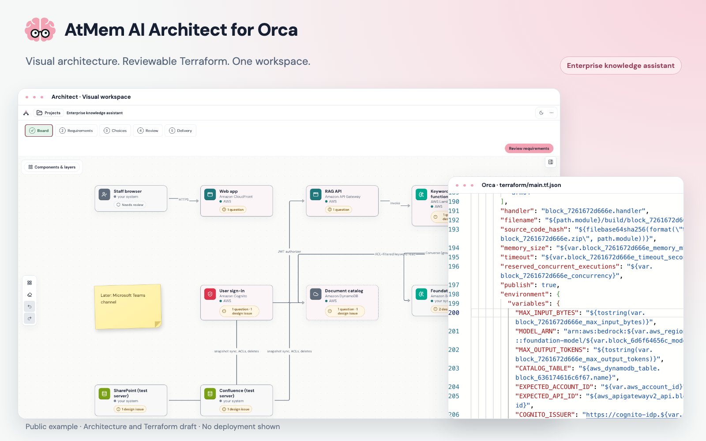
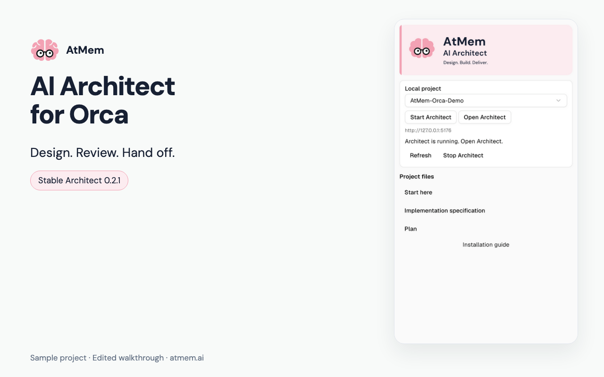

# AtMem AI Architect for Orca

Open AtMem AI Architect’s visual workspace inside Orca. Design applications, review requirements and inspect Terraform beside your code.



[Explore the workspace](assets/architect-workspace.png) · [See Terraform in Orca](assets/terraform-orca.png)

[Public Orca listing](https://orca.dev/plugins/aetna000/atmem-ai-architect-orca)

## Watch the walkthrough

[](https://github.com/aetna000/atmem-ai-architect-orca/releases/download/v0.1.3/atmem-ai-architect-orca-walkthrough.mp4)

Select a project, open Architect, send the design handoff to Orca, and inspect its specifications. Captioned sample walkthrough.

## Install

Requires Orca 1.4.257+, Node.js 22+, and Orca CLI on PATH.

```sh
orca plugin install aetna000/atmem-ai-architect-orca@v0.1.5 --json
```

Orca prints the exact permissions and approval command. Review those before approving.

## Local onboarding preview (0.2.0-local.1)

This branch is a local preview; the public install command above still installs 0.1.5.

1. Open **AtMem AI Architect** in Orca’s right sidebar.
2. For a new idea, enter a project name and choose **Start designing**. No existing folder is required.
3. Architect starts if needed and opens the named design in an Orca browser tab. Connect a model there to begin chatting.
4. To resume existing work, choose **Existing folder**, select its Orca folder, and choose **Open design in Architect**.
5. In Architect, choose **Delivery → Open in Orca**. The panel detects newly registered design folders while open; **Reload folders and files** is the fallback.

A folder’s root or `design-documents/` can contain `*.atmem-ai-architect.json` or `*.atforma.json`. Choose a file when several exist. A folder without a saved design starts a named blank design; existing source code is not imported. Invalid designs are reported rather than replaced with a blank canvas.

Imported designs are saved through Architect’s authenticated local project API and opened using their actual project ID. Subsequent opens preserve edits already saved in Architect; they do not overwrite them with an older exported snapshot. Missing linked designs must be restored in Architect’s Projects instead of silently recreated.

New-project folders live in `~/.atmem-architect/orca-projects/`. Designs live in the configured Architect data store. No source repository files are modified. Reusing the same new-project name resumes its linked folder, including after a startup retry.

Startup shows progress and waits for readiness. Slow first-time installation can outlast the wait; retry after setup finishes. Runtime address and **Stop local Architect** are under **Help and runtime**. Stop is shown only when the plugin has a terminal session record. It closes that recorded terminal, not an independent application. Change the port in Orca’s plugin settings if another app occupies it.

## Access

The trusted worker can run Node code with your account’s access. Orca also grants workspace read/write, terminal commands, and the plugin’s own storage/settings. Implementation restricts actions to local workspaces, plugin-created project folders, a fixed npm command, and listed design/document paths. It rejects remote workspaces, path traversal, symlink documents and a local port serving another app.

The panel has no direct network access. The worker checks the chosen loopback port and uses Orca CLI to open its browser. npm startup can download the pinned Architect and managed dependencies. Nothing runs automatically when the plugin is enabled. No telemetry, account tokens, project uploads or automatic model calls are added.

## Compatibility

Tested on macOS arm64 with Orca 1.4.257. This version starts stable Architect 0.2.1, including AtMem 2.3.14. Windows/Linux plugin execution remains unqualified.

This plugin opens and inspects a handoff; it does not prove generation quality, run project code or deploy cloud resources. [Validation](evidence/validation.md) · [Plan](docs/plan.md) · [Architect](https://atmem.ai/ai-architect/)

## Develop

```sh
npm ci
orca plugin types . --json
npm run typecheck
npm test
npm run check
```

For live development, use `orca plugin dev load . --json` and review its approval request. Development folders run as `local.atmem-architect`; a Git install runs as `aetna000.atmem-architect`.

AtMem-owned code: Apache-2.0. This is an AtMem integration, not an Orca-endorsed plugin.
