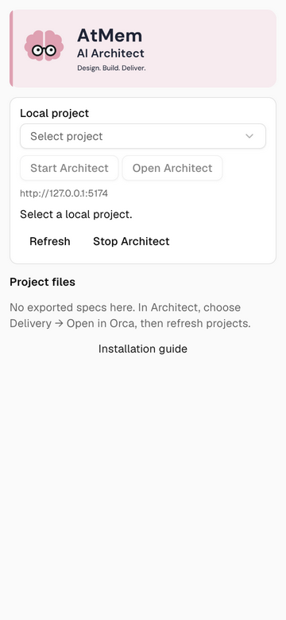

# AtMem AI Architect for Orca

Design in Architect. Open the local UI inside Orca. Inspect the exported specifications beside your code.

## Install

Requires Orca 1.4.257+, Node.js 22+, and Orca CLI on PATH.

```sh
orca plugin install aetna000/atmem-ai-architect-orca@v0.1.2 --json
```

Orca prints the exact permissions and approval command. Review those before approving.



## Use

1. Open **AtMem AI Architect** in Orca’s right sidebar and select a local project.
2. **Start Architect** opens a dedicated terminal running `npx --yes @atmem/architect@0.2.0 --no-open`.
3. When the terminal prints its address, choose **Open Architect**.
4. Design in Architect, then choose **Delivery → Open in Orca**.
5. **Refresh** the plugin, select the imported folder, and open its specifications or run instructions.

**Stop Architect** closes only the terminal started by this plugin, stopping its process. It does not stop an independently started application. Change the local port in the plugin’s Orca settings when needed.

## Access

The trusted worker can run Node code with your account’s access. Orca also grants workspace read/write, terminal commands, and the plugin’s own storage/settings. Implementation restricts actions to selected local workspaces, a fixed npm command, and listed document paths. It rejects remote workspaces, path traversal, symlink documents and a local port serving another app.

The panel has no direct network access. The worker checks the chosen loopback port and uses Orca CLI to open its browser. npm startup can download the pinned Architect and managed dependencies. Nothing runs automatically when the plugin is enabled. No telemetry, account tokens, project uploads or automatic model calls are added.

## Compatibility

Tested on macOS arm64 with Orca 1.4.257 and the published Architect 0.2.0. Windows/Linux plugin execution is unqualified. Architect 0.2.0 includes its previously qualified AtMem runtime; the separate Architect runtime update must be released before npm users receive it.

This plugin opens and inspects a handoff; it does not prove generation quality, run project code or deploy cloud resources. [Validation](evidence/validation.md) · [Plan](docs/plan.md) · [Architect](https://atmem.ai/ai-architect/)

## Develop

```sh
npm ci
orca plugin types . --json
npm run typecheck
npm test
npm run check
```

For live development, use `orca plugin dev load . --json` and review its approval request. Development folders run as `local.atmem-architect`; a Git install runs as `aetna000.atmem-architect`.

AtMem-owned code: Apache-2.0. This is an AtMem integration, not an Orca-endorsed plugin.
